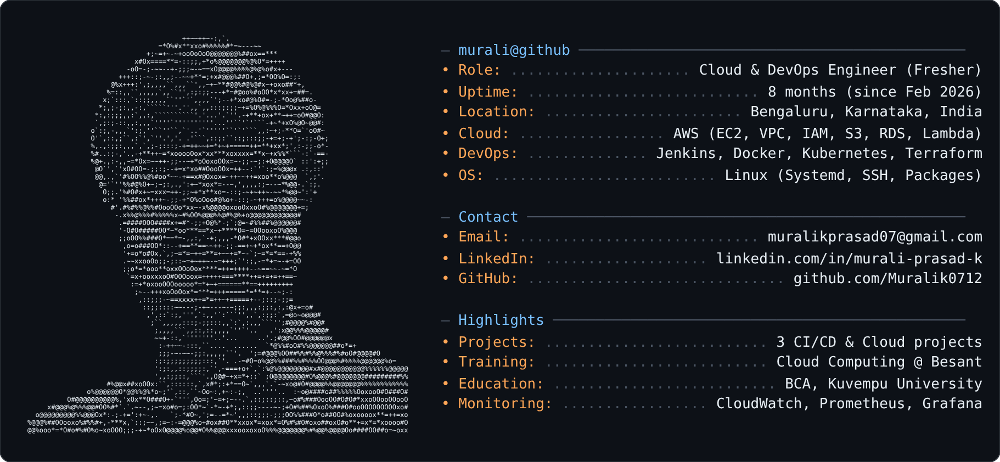

## About Me

Hi, I'm **Murali Prasad K** 👋
I'm a fresher passionate about **AWS, DevOps and CI/CD automation**. I completed a Cloud Computing course at **Besant Technologies** (Feb–Aug 2026) with hands-on work in Linux, Docker, Kubernetes, Jenkins and Terraform. I enjoy troubleshooting, solving problems and learning something new every day.

🔭 Building CI/CD pipelines and cloud infrastructure
🌱 Learning: Kubernetes in depth, Terraform modules, observability
📍 Bengaluru, Karnataka, India

## Tech Stack

| Area | Skills |
|---|---|
| **CI/CD** | Jenkins, Git, GitHub, Webhooks, Branching Strategies, Release Management |
| **Containers** | Docker, Dockerfiles, Kubernetes (Pods, Deployments, Services, ConfigMaps, Secrets) |
| **Cloud & Linux** | AWS (EC2, VPC, IAM, S3, RDS, Lambda), SSH, Systemd, Package Management |
| **IaC** | Terraform (Variables, State, Modules), Ansible |
| **Networking** | OSI Model, DNS, DHCP, HTTP/HTTPS |
| **Monitoring** | CloudWatch, Prometheus, Grafana, Alerting |

## Projects

### 🚀 End-to-End CI/CD Pipeline: Jenkins, Docker, Kubernetes & AWS
- Jenkins automates builds from GitHub via webhook triggers
- Java app built with Maven, containerized with Docker, image pushed to a registry
- Deployed to an **Amazon EKS** cluster and verified

### ☕ CI/CD Pipeline for Java Web App: Jenkins & Tomcat
- GitHub + Jenkins webhooks for automated builds
- Maven build, WAR deployed to **Apache Tomcat on AWS EC2**
- Verified through the browser

### 🌐 Static Website Hosting: CloudFront & S3
- Site files in a **private S3 bucket**
- Delivered through **CloudFront** with low latency and edge caching
- Secured with **Origin Access Control (OAC)** and bucket policies

> 🔗 Add each repo link here, e.g. `[View Repo](https://github.com/Muralik0712/repo-name)`

## Experience & Education

- **Cloud Computing Trainee / Intern**, Besant Technologies, Bengaluru (Feb 2026 – Aug 2026)
- **BCA**, Kuvempu University, Shivamogga (2021 – 2024)

## GitHub Stats

  
  

## Connect With Me

